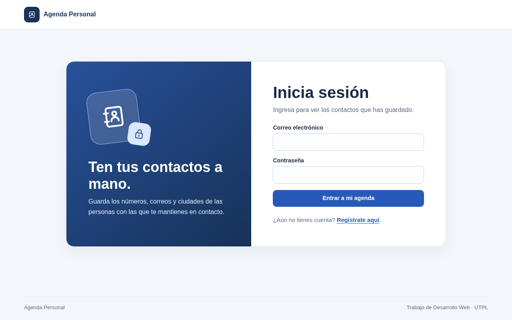
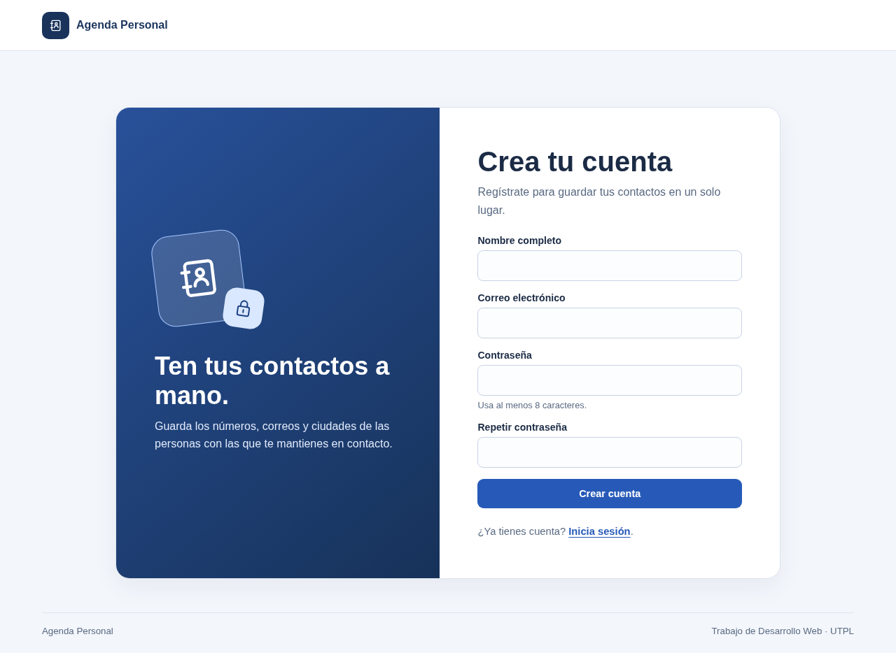

# Agenda Personal de Contactos — Actividad B1

Esta es la segunda versión de mi agenda de contactos. En la primera práctica podía registrarme, iniciar sesión y guardar, editar o eliminar contactos. En esta actividad añadí herramientas para encontrar los contactos más rápido y tenerlos mejor organizados, además de preparar el proyecto para publicarlo en Internet.

**Proyecto:** Desarrollo Web, UTPL  
**Repositorio:** https://github.com/KEN101010/agenda-personal-utpl-entrega  
**URL pública:** PENDIENTE: pegar aquí la dirección definitiva de Hostinger después de publicarlo y comprobar que funciona.

> Importante: todavía hay que configurar los datos de MySQL del hosting e importar el script. No se incluyen contraseñas ni una URL inventada.

## Qué puede hacer la agenda

- Crear una cuenta con nombre, correo y contraseña.
- Iniciar y cerrar sesión para acceder a una agenda privada.
- Añadir contactos con nombre, teléfono, correo electrónico y ciudad.
- Editar y eliminar contactos, con confirmación antes de borrarlos.
- **Buscar** por nombre, correo, ciudad o los tres campos al mismo tiempo.
- **Ordenar** por nombre (A-Z o Z-A), ciudad (A-Z o Z-A) y fecha de creación (más recientes o antiguos).
- **Organizar** cada contacto en Familia, Amigos, Trabajo, Universidad u Otro.
- **Marcar favoritos**, quitar la marca y mostrar únicamente los favoritos.
- Combinar búsqueda, categoría, favoritos y ordenamiento desde el mismo panel.

Los contactos pertenecen a la cuenta que los creó. Un usuario no puede ver ni cambiar los de otra persona.

## Qué cambió con respecto a la primera versión

| Antes | Ahora |
| --- | --- |
| La tabla mostraba los contactos ordenados por nombre. | Se puede elegir entre varias formas de ordenar. |
| Había que recorrer la lista para encontrar a alguien. | Se puede buscar por nombre, correo o ciudad. |
| Los contactos no tenían categorías. | Cada contacto se guarda en una de cinco categorías. |
| No había una manera de destacar contactos. | Se pueden marcar como favoritos y filtrarlos. |
| Base de datos con usuarios y contactos. | Se añadió `categorias` y los campos `categoria_id`, `favorito` y `fecha_creacion`. |
| Instalación explicada para XAMPP. | También se documenta cómo subirla a Hostinger. |

## Tecnologías utilizadas

- PHP 8.1 o superior para las páginas, la validación y las sesiones.
- MySQL o MariaDB para guardar usuarios y contactos.
- PDO y consultas preparadas para trabajar con la base de datos.
- HTML5 y CSS3 para la interfaz adaptable a computadora y celular.
- Apache y `.htaccess` para proteger los archivos internos.
- Git y GitHub para mantener el código del proyecto.

No hace falta instalar paquetes con Composer o npm. El diseño usa CSS y pequeños iconos SVG incluidos en el código.

## Cómo instalarlo en XAMPP

1. Instala XAMPP y enciende **Apache** y **MySQL** desde el panel.
2. Copia los archivos del proyecto a `C:\xampp\htdocs\agenda-personal\`. Debe existir `C:\xampp\htdocs\agenda-personal\index.php`.
3. Abre `http://localhost/phpmyadmin`, crea una base llamada `agenda_personal` con `utf8mb4` e impórtale `database.sql`.
4. Revisa `config/database.php`: por defecto utiliza `127.0.0.1`, puerto `3306`, base `agenda_personal`, usuario `root` y contraseña vacía (configuración típica de XAMPP, no de un servidor público).
5. Si tu instalación usa otros datos, copia `config/database.local.example.php` a `config/database.local.php` y cambia los valores.
6. Abre `http://localhost/agenda-personal/`, crea tu cuenta y prueba el directorio.

Si Apache usa un puerto distinto, ajústalo en el enlace. Si ya tienes datos de la primera versión, **no importes `database.sql` encima para actualizarlos**: haz una copia de seguridad y usa `migracion_desde_v1.sql` una sola vez sobre las tablas antiguas.

## Cómo publicarlo en Hostinger

La explicación paso a paso está en [GUIA_HOSTINGER.md](GUIA_HOSTINGER.md). Resumen:

1. En Hostinger, crea un sitio **PHP/HTML** asociado a tu dominio o subdominio, con un plan que permita PHP y MySQL.
2. En **Bases de datos**, crea una base MySQL y anota el nombre, usuario, contraseña y host que te muestra hPanel.
3. En phpMyAdmin selecciona esa base e importa `database.sql` si es una instalación nueva.
4. Sube los archivos PHP y las carpetas `assets`, `includes` y `config` a `public_html`. `index.php` debe estar directamente en esa carpeta.
5. Dentro de `public_html/config`, duplica `database.local.example.php` como `database.local.php` y coloca los datos de MySQL del hosting. No subas ese archivo a GitHub.
6. Abre la URL pública, registra una cuenta de prueba y comprueba las funcionalidades.
7. Coloca la URL real aquí y agrega las capturas en `docs/capturas/` antes de entregar la práctica.

**No confundas el usuario de Hostinger con el de MySQL:** en `database.local.php` se necesita el usuario de la base de datos, no el correo con el que entras al panel.

## Estructura del proyecto

```text
assets/css/app.css                Estilos de la página
config/database.php              Configuración local básica
config/database.local.example.php Ejemplo para Hostinger
includes/                        Funciones compartidas y formularios
index.php                        Entrada de la aplicación
registro.php                     Registro de usuarios
login.php                        Inicio de sesión
dashboard.php                    Listado, búsqueda, filtros y ordenamiento
crear.php                        Nuevo contacto
editar.php                       Edición de contacto
favorito.php                     Marcar y quitar favoritos
confirmar.php                    Confirmación de borrado
eliminar.php                     Borrado de contacto
logout.php                       Cierre de sesión
database.sql                     Base de datos de instalación nueva
migracion_desde_v1.sql           Actualización desde la primera práctica
GUIA_HOSTINGER.md                Instrucciones de despliegue
```

## Capturas de pantalla

Estas dos imágenes corresponden a las pantallas de acceso y registro de esta versión, renderizadas en una prueba local con PHP y el CSS del proyecto.





**Pendiente tras el despliegue:** añade una captura real del directorio con un contacto de prueba y las nuevas opciones (buscador, categoría y favoritos). Puedes guardarla como `docs/capturas/directorio.png` y agregarla aquí con:

```markdown

```

No se incluyen capturas de contactos simulados ni datos privados.

## Pruebas que hice / debo repetir al publicarlo

Antes de entregar revisa lo siguiente usando datos de prueba:

1. Registra una cuenta, cierra sesión y vuelve a entrar.
2. Crea un contacto de cada categoría. Edita el correo y la ciudad de uno.
3. Busca un contacto por nombre; después por correo y por ciudad.
4. Cambia el orden por nombre, ciudad y fecha para comprobar los resultados.
5. Marca dos contactos como favoritos, activa **Solo favoritos** y quita la marca a uno.
6. Combina el filtro de categoría con la búsqueda y el ordenamiento.
7. Borra un contacto y verifica que desaparece.
8. Abre la agenda desde otro navegador o desde el teléfono.
9. Con otra cuenta, comprueba que no aparecen los contactos de la primera.

**Estado técnico del paquete:** los archivos PHP se revisaron sintácticamente. La prueba de conexión y de funcionamiento real en Hostinger queda pendiente hasta configurar el hosting y la base de datos.

## Cuidados de seguridad

Las contraseñas de usuarios se almacenan con `password_hash`, y en el inicio de sesión se comprueban con `password_verify`. Se usan sesiones con cookies `HttpOnly`, validación de formularios, tokens CSRF y consultas preparadas. Cada consulta de contactos verifica quién es el propietario. El archivo `config/database.local.php` está incluido en `.gitignore` y no debe publicarse en el repositorio.

---

**Nota de entrega:** lo que el docente solicita al final es la **URL pública**, el **enlace de GitHub actualizado** y el **script SQL**. Recuerda poner esos tres enlaces o archivos en la plataforma de la materia.
